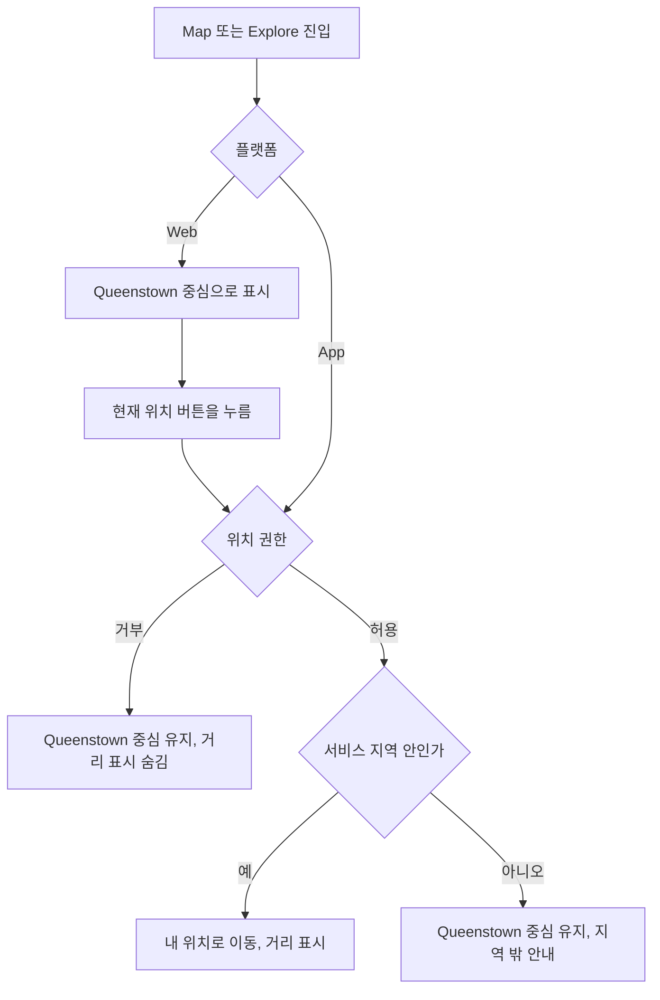
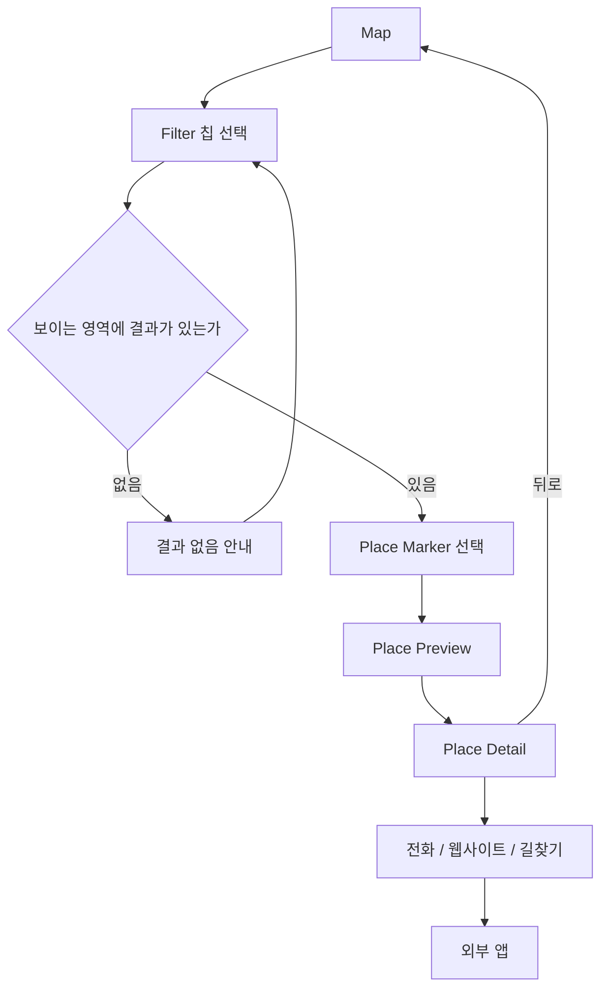
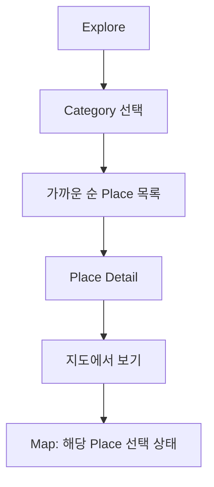
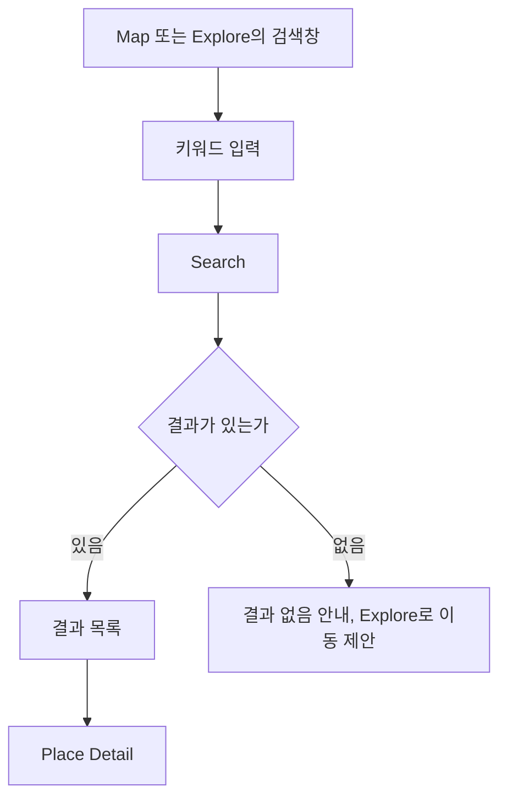
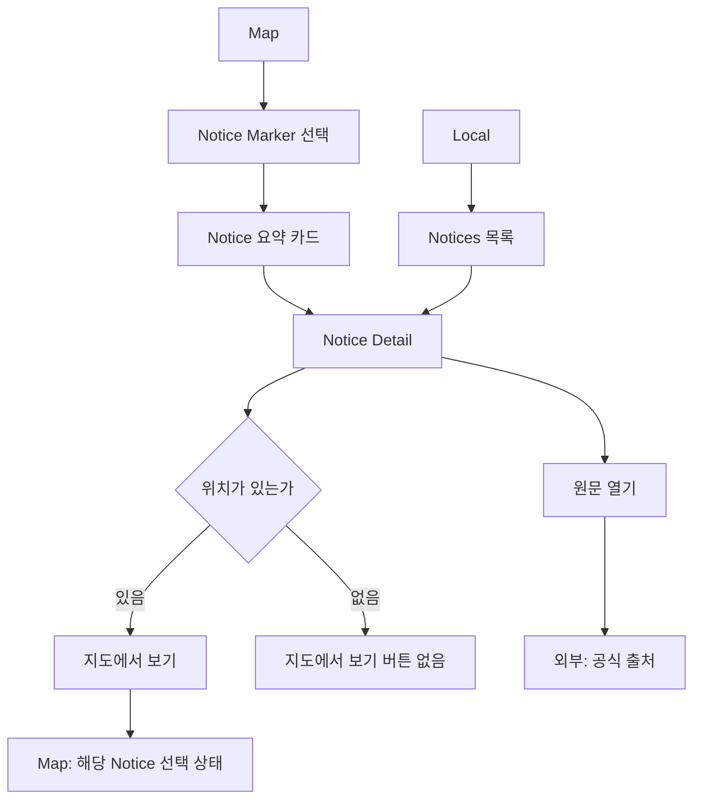
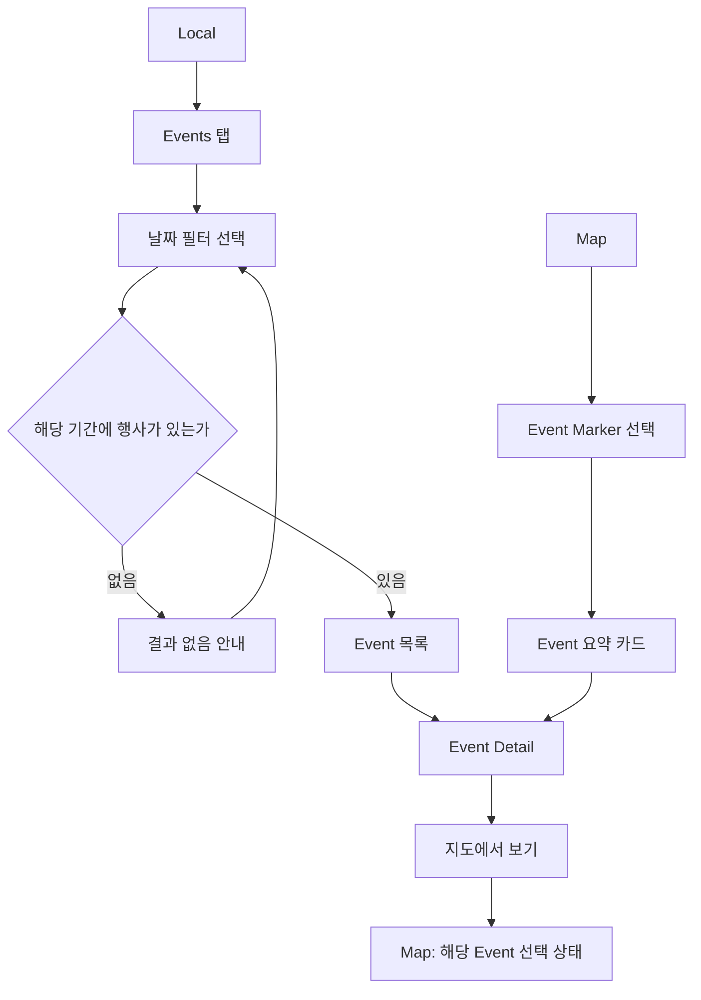
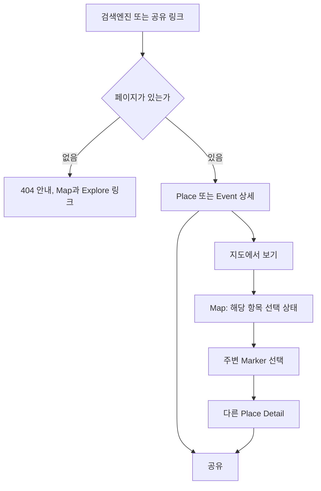
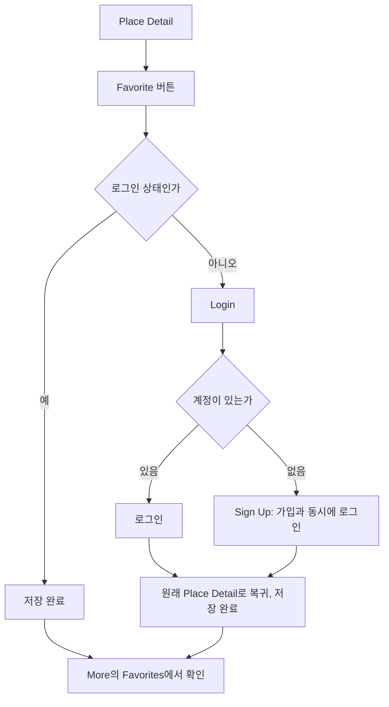
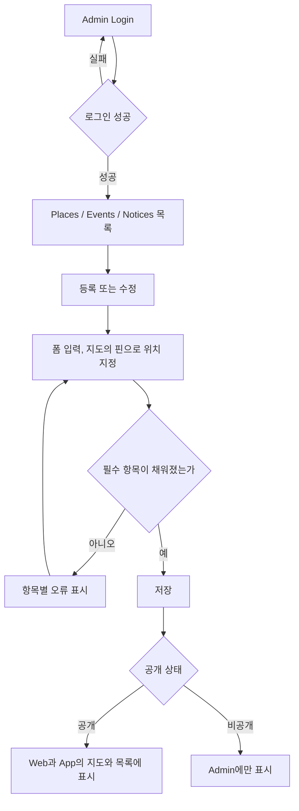

# User Flow v1

Queenstown Local Platform MVP에서 사용자가 화면 사이를 어떻게 이동하는지 정의한다.

- 작성일: 2026-10-07
- 상태: v1 (확정)
- 기준 문서: [MVP Feature Definition v1](01-mvp-feature-definition.md), [Information Architecture v1](02-information-architecture.md)

시나리오 ID(S1 ~ S5)와 Feature ID는 MVP Feature Definition v1의 것을, 화면 이름과 URL은 Information Architecture v1의 것을 그대로 사용한다.

---

## 1. Flow 목록

| ID | Flow | 시나리오 | 플랫폼 | 우선순위 |
|---|---|---|---|---|
| UF-01 | 위치 확인 (공통) | S1 | Web · App | Must |
| UF-02 | 지도에서 장소 찾기 | S1 | Web · App | Must |
| UF-03 | 목록에서 장소 찾기 | S1 | Web · App | Must |
| UF-04 | 장소 검색 | S1 | Web · App | Must |
| UF-05 | 공지 확인 | S2 | Web · App | Must |
| UF-06 | 행사 찾기 | S3 | Web · App | Must |
| UF-07 | 검색 유입 | S4 | Web | Must |
| UF-08 | Favorite 저장 | 없음 | Web · App | Should |
| UF-09 | Admin 데이터 등록 | S5 | Admin | Should |

---

## 2. 공통 규칙

### 뒤로 가기

- 상세에서 뒤로 가면 직전 화면을 떠날 때의 상태(지도 위치, 필터, 선택한 카드, 목록의 스크롤 위치)로 돌아온다.
- 검색 유입으로 상세에 바로 들어온 사용자는 돌아갈 화면이 없다. 내비게이션과 "지도에서 보기"로 다음 화면을 제공한다.

### 상태 안내 (COMMON-02)

| 화면 | 결과가 없을 때 | 불러오지 못했을 때 |
|---|---|---|
| Map | 이 영역에 결과가 없다고 알리고, 선택한 칩을 해제하도록 제안한다. | 안내와 다시 시도 |
| Explore | 해당 Category에 장소가 없다고 알린다. | 안내와 다시 시도 |
| Search | 결과가 없다고 알리고, Explore로 이동하도록 제안한다. | 안내와 다시 시도 |
| Notices | 현재 유효한 공지가 없다고 알린다. | 안내와 다시 시도 |
| Events | 해당 기간에 행사가 없다고 알리고, 날짜 필터를 해제하도록 제안한다. | 안내와 다시 시도 |
| 상세 | 없거나 비공개인 항목은 404 안내와 함께 Map, Explore 링크를 제공한다. | 안내와 다시 시도 |

### Web과 App의 차이

| 항목 | Web | App |
|---|---|---|
| 위치 권한을 요청하는 시점 | 현재 위치 버튼을 누를 때 | 처음 실행할 때 |
| Notice / Event 진입 | Local의 목록, Map의 Marker | Map의 Marker (Local Tab은 Should) |
| 길찾기 | 외부 지도 서비스 | 기기의 지도 앱 |
| 공유 | 링크 복사 또는 브라우저의 공유 기능 | 기기의 공유 화면으로 Web URL을 공유 |
| 검색 유입 (UF-07) | 있음 | 없음 |

---

## 3. UF-01 위치 확인 (공통)

Map과 Explore에서 현재 위치를 사용할 때의 공통 흐름이다.



| 단계 | 화면 | 사용자 행동 | 시스템 응답 | Feature |
|---|---|---|---|---|
| 1 | Map, Explore | 화면에 들어온다. | Web은 권한을 묻지 않고 Queenstown 중심으로 표시한다. App은 처음 실행할 때 권한을 요청한다. | MAP-01, COMMON-01 |
| 2 | Map, Explore | (Web) 현재 위치 버튼을 누른다. | 위치 권한을 요청한다. | MAP-02 |
| 3 | Map, Explore | 권한을 허용한다. | 내 위치로 지도를 옮기고, 목록과 Preview에 거리를 표시한다. | MAP-02, PLACE-03 |

분기

- **권한 거부**: Queenstown 중심을 기준으로 지도와 목록을 표시하고 거리는 숨긴다. 이후 현재 위치 버튼을 누르면 권한을 켜는 방법을 안내한다.
- **서비스 지역 밖**: 현재 위치가 Queenstown 중심에서 50km 넘게 떨어져 있으면 지도를 옮기지 않고, 서비스 지역 밖이라고 알린다. 거리는 숨긴다.
- **이전에 허용한 사용자**: Web에서도 다시 묻지 않고 현재 위치를 사용한다.

Web에서 처음부터 권한을 묻지 않는 이유는 검색 유입 사용자 때문이다. 이들은 대부분 Queenstown 밖에 있고, 페이지를 열자마자 권한 요청을 받으면 이탈하기 쉽다.

---

## 4. UF-02 지도에서 장소 찾기 (S1)



| 단계 | 화면 | 사용자 행동 | 시스템 응답 | Feature |
|---|---|---|---|---|
| 1 | Map | 서비스를 연다. | Queenstown 지도와 보이는 영역의 Marker를 표시한다. | MAP-01, MAP-03 |
| 2 | Map | Filter 칩을 누른다. | 선택한 칩의 Marker만 남긴다. | MAP-04 |
| 3 | Map | 지도를 이동하거나 확대한다. | 보이는 영역의 Marker를 갱신한다. | MAP-08 |
| 4 | Map | Place Marker를 누른다. | Place Preview를 표시한다. | MAP-05 |
| 5 | Place Preview | 카드를 누른다. | Place Detail로 이동한다. | PLACE-04 |
| 6 | Place Detail | 전화, 웹사이트, 길찾기 중 하나를 누른다. | 외부 앱을 연다. | PLACE-05 |

분기

- **결과 없음**: 보이는 영역에 결과가 없으면 안내하고 칩 해제를 제안한다.
- **정보가 없는 행동**: 전화번호나 웹사이트가 없는 장소는 해당 버튼을 표시하지 않는다.
- **Should**: 지도를 축소하면 겹치는 Marker를 묶는다(MAP-09). Preview와 상세에 영업 중 여부를 표시한다(PLACE-07).

---

## 5. UF-03 목록에서 장소 찾기 (S1)



| 단계 | 화면 | 사용자 행동 | 시스템 응답 | Feature |
|---|---|---|---|---|
| 1 | Explore | Explore를 연다. | Place 목록을 가까운 순으로 표시한다. | PLACE-01, PLACE-03 |
| 2 | Explore | Category를 고른다. | 해당 Category의 장소만 표시한다. | PLACE-02 |
| 3 | Explore | 목록의 장소를 누른다. | Place Detail로 이동한다. | PLACE-04 |
| 4 | Place Detail | "지도에서 보기"를 누른다. | 해당 장소를 선택한 상태의 Map으로 이동한다. | PLACE-06 |

분기

- **위치를 사용할 수 없을 때**: Queenstown 중심에서 가까운 순으로 정렬하고 거리는 숨긴다(UF-01).

---

## 6. UF-04 장소 검색 (S1)



| 단계 | 화면 | 사용자 행동 | 시스템 응답 | Feature |
|---|---|---|---|---|
| 1 | Map, Explore | 검색창에 이름이나 키워드를 입력한다. | Search로 이동해 결과를 표시한다. | SEARCH-01 |
| 2 | Search | 결과의 장소를 누른다. | Place Detail로 이동한다. | SEARCH-02 |

분기

- **Should**: 검색 결과를 지도의 Marker로 본다(SEARCH-03).

---

## 7. UF-05 공지 확인 (S2)

진입 경로는 Map의 Marker와 Local의 목록 두 가지다.



| 단계 | 화면 | 사용자 행동 | 시스템 응답 | Feature |
|---|---|---|---|---|
| 1a | Map | Notice Marker를 누른다. | 유형, 제목, 기간이 담긴 요약 카드를 표시한다. | MAP-07 |
| 1b | Notices | Local을 눌러 목록을 본다. | 유효한 공지를 최신순으로 표시한다. | NOTICE-01, NOTICE-05 |
| 2 | Notice Detail | 카드나 목록의 공지를 누른다. | 유형, Official 표시, 기간, 요약, 출처를 표시한다. | NOTICE-02 |
| 3 | Notice Detail | "지도에서 보기"를 누른다. | 해당 공지를 선택한 상태의 Map으로 이동한다. | NOTICE-04 |
| 4 | Notice Detail | "원문 열기"를 누른다. | 공식 출처 페이지를 연다. | NOTICE-03 |

분기

- **위치가 없는 공지**: 목록에만 나오고, 상세에 "지도에서 보기"를 표시하지 않는다.
- **종료된 공지**: 목록과 지도에 나오지 않는다. 상세 URL로 직접 들어오면 종료되었다고 표시한다.
- **App**: Local Tab이 없으면 Map의 Notices 칩과 Marker로 진입한다. Local Tab(APP-01)은 Should다.
- **Should**: 목록을 유형으로 좁힌다(NOTICE-06).

---

## 8. UF-06 행사 찾기 (S3)



| 단계 | 화면 | 사용자 행동 | 시스템 응답 | Feature |
|---|---|---|---|---|
| 1a | Events | Local에서 Events 탭을 누른다. | 예정되었거나 진행 중인 행사를 날짜순으로 표시한다. | EVENT-01, EVENT-05 |
| 1b | Map | Event Marker를 누른다. | 제목, 일시, 장소가 담긴 요약 카드를 표시한다. | MAP-06 |
| 2 | Events | 날짜 필터(Today / This Week / This Month)를 고른다. | 해당 기간의 행사만 표시한다. | EVENT-02 |
| 3 | Event Detail | 목록이나 카드의 행사를 누른다. | 제목, 일시, 장소, 설명, 출처 링크를 표시한다. | EVENT-03 |
| 4 | Event Detail | "지도에서 보기"를 누른다. | 해당 행사를 선택한 상태의 Map으로 이동한다. | EVENT-04 |

분기

- **종료된 행사**: 목록과 지도에 나오지 않는다. 상세 URL로 직접 들어오면 종료되었다고 표시한다.
- **App**: Local Tab이 없으면 Map의 Events 칩과 Marker로 진입한다.

---

## 9. UF-07 검색 유입 (S4)

검색엔진이나 공유 링크로 상세 페이지에 바로 들어오는 흐름이다. Web에만 있다.



| 단계 | 화면 | 사용자 행동 | 시스템 응답 | Feature |
|---|---|---|---|---|
| 1 | Place Detail, Event Detail | 검색 결과나 공유 링크를 누른다. | 서버에서 렌더링한 상세 페이지를 표시한다. 위치 권한은 묻지 않는다. | SEO-01, PLACE-04, EVENT-03 |
| 2 | Place Detail, Event Detail | "지도에서 보기"를 누른다. | 해당 항목을 선택한 상태의 Map으로 이동한다. | PLACE-06, EVENT-04 |
| 3 | Map | 주변의 다른 Marker를 누른다. | Preview를 거쳐 다른 상세로 이동한다. | MAP-03, MAP-05 |
| 4 | Place Detail, Event Detail | 공유를 누른다. | 링크를 복사하거나 공유한다. | COMMON-05 |

분기

- **없는 페이지**: 없거나 비공개인 항목은 404 안내와 함께 Map, Explore 링크를 제공한다.
- **Should**: 상세 하단에서 주변 장소를 바로 본다(PLACE-08).

---

## 10. UF-08 Favorite 저장 (Should)

로그인이 필요한 유일한 흐름이다.



| 단계 | 화면 | 사용자 행동 | 시스템 응답 | Feature |
|---|---|---|---|---|
| 1 | Place Detail | Favorite 버튼을 누른다. | 로그인 상태면 바로 저장한다. 아니면 Login으로 이동한다. | FAV-01 |
| 2 | Login, Sign Up | 로그인하거나 가입한다. | 원래 보던 Place Detail로 돌아와 저장을 완료한다. | USER-01, USER-02 |
| 3 | Favorites | More에서 Favorites를 연다. | 저장한 장소 목록을 표시한다. | FAV-02 |

분기

- **이미 저장한 장소**: 버튼을 다시 누르면 저장을 해제한다.
- **로그아웃**: More에서 로그아웃한다(USER-02).

---

## 11. UF-09 Admin 데이터 등록 (S5)

Place, Event, Notice 모두 같은 흐름이다.



| 단계 | 화면 | 사용자 행동 | 시스템 응답 | Feature |
|---|---|---|---|---|
| 1 | Admin Login | 관리자 계정으로 로그인한다. | 목록으로 이동한다. | ADMIN-01 |
| 2 | 목록 | 등록을 누르거나 수정할 항목을 고른다. | 폼을 표시한다. | ADMIN-02, ADMIN-03, ADMIN-04 |
| 3 | 등록 / 수정 | 내용을 입력하고 지도의 핀으로 위치를 지정한다. | 필수 항목을 확인한다. | ADMIN-02, ADMIN-03, ADMIN-04 |
| 4 | 등록 / 수정 | 공개 상태를 정하고 저장한다. | 공개한 항목을 Web과 App에 표시한다. | ADMIN-02, ADMIN-03, ADMIN-04 |

분기

- **삭제 대신 비공개**: 항목은 삭제하지 않고 비공개로 바꾼다. 비공개 항목의 상세 URL은 404로 응답한다.
- **Notice의 위치**: 위치는 선택 항목이다. 지정하지 않으면 목록에만 나온다.

---

## 12. Flow에 속하지 않는 Feature

화면 이동이 아니라 전체에 적용되거나 단독 화면인 항목이다.

| Feature | 내용 |
|---|---|
| NAV-01, NAV-02 | 내비게이션 |
| COMMON-03 | 반응형 화면 |
| COMMON-04 | i18n 구조 |
| SEO-02 | Sitemap / robots |
| MORE-01, MORE-02, MORE-03 | About, 정보 수정 요청, Privacy Policy / Terms |

---

## 13. 다음 단계

```text
User Flow
 ↓
Wireframe
 ↓
ERD
 ↓
API Specification
```
