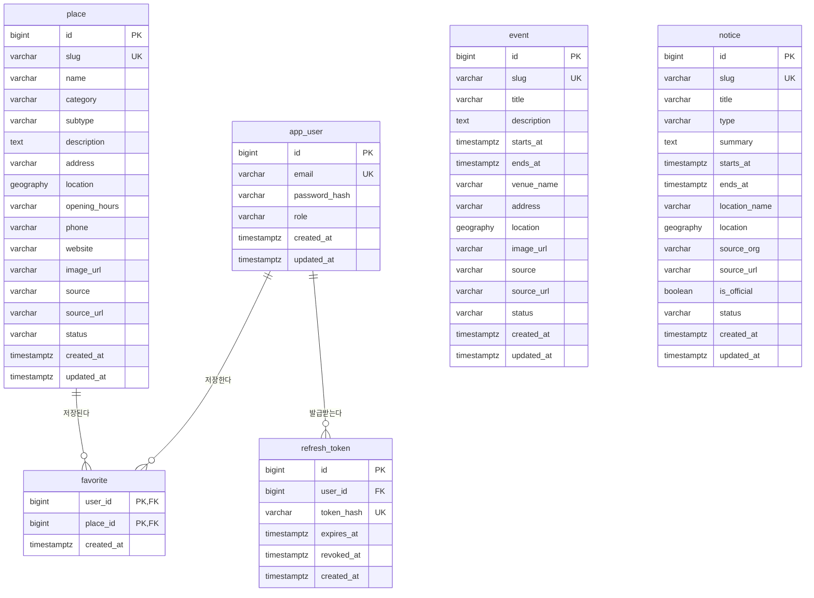

# ERD v1

Queenstown Local Platform MVP의 데이터 구조를 정의한다.

- 작성일: 2026-10-07
- 상태: v1 (확정)
- 기준 문서: [MVP Feature Definition v1](01-mvp-feature-definition.md), [Information Architecture v1](02-information-architecture.md), [Wireframe v1](04-wireframe.md)
- 대상: PostgreSQL + PostGIS, MyBatis

Must 범위와 11주차에 개발하는 Should(User, Favorite, Admin)까지 포함한다.

---

## 1. 설계 원칙

1. **콘텐츠는 Place, Event, Notice 세 테이블이다.** MVP에서는 서로 참조하지 않는다. Event와 Notice는 각자 위치를 가진다.
2. **위치는 PostGIS의 `geography(Point, 4326)` 한 컬럼에 저장한다.** 거리와 반경을 미터 단위로 계산한다. API에서는 `latitude`, `longitude`로 내보낸다.
3. **공개 식별자는 `slug`다.** URL에 쓰고, 한 번 공개하면 바꾸지 않는다. `id`는 내부와 Admin에서만 쓴다.
4. **삭제하지 않고 `status`로 내린다.** `public`과 `private` 두 값이다.
5. **분류는 코드 값으로 저장하고 CHECK 제약으로 지킨다.** 별도 테이블을 두지 않는다. 코드 값은 URL의 slug와 같은 문자열을 쓴다.
6. **모든 콘텐츠에 출처를 남긴다.** Place와 Event는 `source`, `source_url`, Notice는 `source_org`, `source_url`이 필수다.
7. **시각은 `timestamptz`로 저장하고, 날짜 판단은 `Pacific/Auckland` 기준으로 한다.**
8. **컬럼은 snake_case, API와 Java는 camelCase다.** MyBatis의 `mapUnderscoreToCamelCase`로 대응한다.

### 분류를 테이블로 두지 않는 이유

Category는 Marker 아이콘, UI 문구, `/explore/{category}` 경로와 함께 움직인다. 이 셋은 모두 Web과 App의 코드에 있어서, Category를 추가하려면 어차피 코드를 고쳐야 한다. 그래서 MVP에서는 `shared`의 상수를 기준으로 삼고 DB는 CHECK 제약으로 값만 지킨다. Admin에서 Category를 관리하게 되면(Later) 테이블로 옮긴다.

---

## 2. ERD



---

## 3. 테이블

### place

| 컬럼 | 타입 | 필수 | 설명 |
|---|---|---|---|
| id | bigint (identity) | O | PK |
| slug | varchar(120) | O | URL 식별자. 고유 |
| name | varchar(120) | O | 이름 |
| category | varchar(20) | O | Category 코드 |
| subtype | varchar(20) | | Public Facility의 하위 유형. `category`가 `facility`일 때만 값이 있다. |
| description | text | | 설명 |
| address | varchar(255) | O | 주소 |
| location | geography(Point, 4326) | O | 위치 |
| opening_hours | varchar(255) | | 영업시간. 화면에 그대로 표시하는 문자열 |
| phone | varchar(30) | | 전화번호. 없으면 Call 버튼을 표시하지 않는다. |
| website | varchar(500) | | 웹사이트. 없으면 Website 버튼을 표시하지 않는다. |
| image_url | varchar(500) | | 대표 이미지 URL |
| source | varchar(120) | O | 출처 이름 |
| source_url | varchar(500) | O | 출처 URL |
| status | varchar(10) | O | 공개 상태. 기본값 `private` |
| created_at | timestamptz | O | 등록 시각 |
| updated_at | timestamptz | O | 수정 시각. 화면의 "Updated"에 표시한다. |

### event

| 컬럼 | 타입 | 필수 | 설명 |
|---|---|---|---|
| id | bigint (identity) | O | PK |
| slug | varchar(160) | O | URL 식별자. 고유 |
| title | varchar(160) | O | 제목 |
| description | text | | 설명 |
| starts_at | timestamptz | O | 시작 시각 |
| ends_at | timestamptz | | 종료 시각. `starts_at` 이후여야 한다. |
| venue_name | varchar(120) | O | 장소 이름. 화면의 "Where"에 표시한다. |
| address | varchar(255) | | 주소 |
| location | geography(Point, 4326) | O | 위치 |
| image_url | varchar(500) | | 대표 이미지 URL |
| source | varchar(120) | O | 출처 이름 |
| source_url | varchar(500) | O | 공식 행사 페이지 URL |
| status | varchar(10) | O | 공개 상태. 기본값 `private` |
| created_at | timestamptz | O | 등록 시각 |
| updated_at | timestamptz | O | 수정 시각 |

### notice

| 컬럼 | 타입 | 필수 | 설명 |
|---|---|---|---|
| id | bigint (identity) | O | PK |
| slug | varchar(160) | O | URL 식별자. 고유 |
| title | varchar(160) | O | 제목 |
| type | varchar(20) | O | Notice 유형 코드 |
| summary | text | O | 요약. 원문 전체를 싣지 않는다. |
| starts_at | timestamptz | O | 시작 시각 |
| ends_at | timestamptz | | 종료 시각. 없으면 `private`으로 바꿀 때까지 표시한다. |
| location_name | varchar(255) | | 위치 설명. 예: "Shotover Street, between Camp St and Stanley St" |
| location | geography(Point, 4326) | | 위치. 없으면 목록에만 나온다. |
| source_org | varchar(120) | O | 출처 기관 |
| source_url | varchar(500) | O | 원문 URL |
| is_official | boolean | O | 공식 출처 여부. 기본값 `false` |
| status | varchar(10) | O | 공개 상태. 기본값 `private` |
| created_at | timestamptz | O | 등록 시각 |
| updated_at | timestamptz | O | 수정 시각. 화면의 "Updated"에 표시한다. |

### app_user

`user`는 PostgreSQL의 예약어라서 `app_user`로 이름 짓는다. 일반 사용자와 관리자를 `role`로 구분한다. 관리자 계정은 가입 화면 없이 Seed로 만든다.

| 컬럼 | 타입 | 필수 | 설명 |
|---|---|---|---|
| id | bigint (identity) | O | PK |
| email | varchar(255) | O | 이메일. 대소문자를 구분하지 않고 고유 |
| password_hash | varchar(255) | O | 비밀번호 해시 |
| role | varchar(10) | O | `user` 또는 `admin`. 기본값 `user` |
| created_at | timestamptz | O | 가입 시각 |
| updated_at | timestamptz | O | 수정 시각 |

### favorite

| 컬럼 | 타입 | 필수 | 설명 |
|---|---|---|---|
| user_id | bigint | O | PK, FK → app_user.id |
| place_id | bigint | O | PK, FK → place.id |
| created_at | timestamptz | O | 저장 시각 |

`private`이 된 Place는 Favorites 목록에서 보이지 않는다. 행은 지우지 않는다.

### refresh_token

로그인을 유지하고 로그아웃할 때 무효로 만들기 위해 Refresh Token을 저장한다. 토큰 원문은 저장하지 않고 해시만 저장한다.

| 컬럼 | 타입 | 필수 | 설명 |
|---|---|---|---|
| id | bigint (identity) | O | PK |
| user_id | bigint | O | FK → app_user.id |
| token_hash | varchar(64) | O | 토큰의 SHA-256 해시. 고유 |
| expires_at | timestamptz | O | 만료 시각 |
| revoked_at | timestamptz | | 무효로 만든 시각 |
| created_at | timestamptz | O | 발급 시각 |

---

## 4. 코드 값

| 대상 | 컬럼 | 값 |
|---|---|---|
| Place Category | place.category | `food`, `cafe`, `bar`, `activity`, `shopping`, `facility` |
| Public Facility 하위 유형 | place.subtype | `toilet`, `parking`, `information`, `library`, `medical`, `other` |
| Notice 유형 | notice.type | `road-work`, `road-closure`, `public-notice`, `emergency` |
| 공개 상태 | status | `public`, `private` |
| 역할 | app_user.role | `user`, `admin` |

---

## 5. 노출 규칙

목록과 지도에 나오는 조건이다. 상세는 `status`가 `public`이면 종료된 뒤에도 열리고, 화면에 종료되었다고 표시한다.

| 대상 | 목록과 지도에 나오는 조건 | Feature |
|---|---|---|
| Place | `status = 'public'` | PLACE-01 |
| Event | `status = 'public'`이고 아직 끝나지 않았다. `ends_at`이 없으면 시작일이 끝날 때까지를 진행 중으로 본다. | EVENT-05 |
| Notice | `status = 'public'`이고 `ends_at`이 없거나 아직 지나지 않았다. | NOTICE-05 |
| Notice (지도) | 위 조건에 더해 `location`이 있다. | MAP-07 |

정렬

| 목록 | 정렬 |
|---|---|
| Explore, Search | 기준 위치에서 가까운 순 |
| Events | `starts_at` 오름차순 |
| Notices | `starts_at` 내림차순 |

`slug`는 이름이나 제목을 소문자와 하이픈으로 바꿔 만든다. 같은 값이 이미 있으면 뒤에 숫자를 붙인다.

---

## 6. Feature 대응

| Feature | 테이블과 컬럼 |
|---|---|
| MAP-03, MAP-08 | place.location, place.status |
| MAP-04 | place.category, event, notice |
| MAP-05 | place.name, place.category, place.location |
| MAP-06 | event.location, event.starts_at, event.ends_at |
| MAP-07 | notice.location, notice.ends_at |
| PLACE-01 ~ PLACE-03 | place.name, place.category, place.address, place.image_url, place.location |
| PLACE-04 ~ PLACE-06 | place 전체 |
| SEARCH-01 ~ SEARCH-02 | place.name, place.description, place.address |
| EVENT-01 ~ EVENT-05 | event 전체 |
| NOTICE-01 ~ NOTICE-06 | notice 전체 |
| SEO-01, SEO-02 | slug, updated_at |
| USER-01 ~ USER-02 | app_user, refresh_token |
| FAV-01 ~ FAV-02 | favorite |
| ADMIN-01 | app_user.role |
| ADMIN-02 ~ ADMIN-04 | place, event, notice의 모든 컬럼과 status |

### v1에 없는 것

| 항목 | 이유 |
|---|---|
| 요일별 영업시간 | 영업 중 표시(PLACE-07, Should)를 만들 때 `place_opening_hours` 테이블을 추가한다. |
| 이미지 여러 장, 업로드 | Later. MVP는 대표 이미지 URL 하나다. |
| Category 테이블 | Later. Admin의 Category 관리와 함께 추가한다. |
| Business, Community, Jobs | Later |
| Notice의 구간과 영역 | Later. v1은 지점 하나다. |

---

## 7. DB Schema v1

3주차에 Backend의 첫 Migration으로 옮긴다. `updated_at`은 애플리케이션이 수정할 때 갱신한다.

```sql
CREATE EXTENSION IF NOT EXISTS postgis;

CREATE TABLE place (
    id            bigint GENERATED ALWAYS AS IDENTITY PRIMARY KEY,
    slug          varchar(120) NOT NULL,
    name          varchar(120) NOT NULL,
    category      varchar(20)  NOT NULL,
    subtype       varchar(20),
    description   text,
    address       varchar(255) NOT NULL,
    location      geography(Point, 4326) NOT NULL,
    opening_hours varchar(255),
    phone         varchar(30),
    website       varchar(500),
    image_url     varchar(500),
    source        varchar(120) NOT NULL,
    source_url    varchar(500) NOT NULL,
    status        varchar(10)  NOT NULL DEFAULT 'private',
    created_at    timestamptz  NOT NULL DEFAULT now(),
    updated_at    timestamptz  NOT NULL DEFAULT now(),
    CONSTRAINT uq_place_slug UNIQUE (slug),
    CONSTRAINT ck_place_category CHECK (category IN ('food', 'cafe', 'bar', 'activity', 'shopping', 'facility')),
    CONSTRAINT ck_place_subtype CHECK (
        (category = 'facility' AND subtype IS NOT NULL
            AND subtype IN ('toilet', 'parking', 'information', 'library', 'medical', 'other'))
        OR (category <> 'facility' AND subtype IS NULL)
    ),
    CONSTRAINT ck_place_status CHECK (status IN ('public', 'private'))
);

CREATE INDEX ix_place_location ON place USING gist (location);
CREATE INDEX ix_place_status_category ON place (status, category);

CREATE TABLE event (
    id          bigint GENERATED ALWAYS AS IDENTITY PRIMARY KEY,
    slug        varchar(160) NOT NULL,
    title       varchar(160) NOT NULL,
    description text,
    starts_at   timestamptz  NOT NULL,
    ends_at     timestamptz,
    venue_name  varchar(120) NOT NULL,
    address     varchar(255),
    location    geography(Point, 4326) NOT NULL,
    image_url   varchar(500),
    source      varchar(120) NOT NULL,
    source_url  varchar(500) NOT NULL,
    status      varchar(10)  NOT NULL DEFAULT 'private',
    created_at  timestamptz  NOT NULL DEFAULT now(),
    updated_at  timestamptz  NOT NULL DEFAULT now(),
    CONSTRAINT uq_event_slug UNIQUE (slug),
    CONSTRAINT ck_event_period CHECK (ends_at IS NULL OR ends_at >= starts_at),
    CONSTRAINT ck_event_status CHECK (status IN ('public', 'private'))
);

CREATE INDEX ix_event_location ON event USING gist (location);
CREATE INDEX ix_event_starts_at ON event (starts_at);

CREATE TABLE notice (
    id            bigint GENERATED ALWAYS AS IDENTITY PRIMARY KEY,
    slug          varchar(160) NOT NULL,
    title         varchar(160) NOT NULL,
    type          varchar(20)  NOT NULL,
    summary       text         NOT NULL,
    starts_at     timestamptz  NOT NULL,
    ends_at       timestamptz,
    location_name varchar(255),
    location      geography(Point, 4326),
    source_org    varchar(120) NOT NULL,
    source_url    varchar(500) NOT NULL,
    is_official   boolean      NOT NULL DEFAULT false,
    status        varchar(10)  NOT NULL DEFAULT 'private',
    created_at    timestamptz  NOT NULL DEFAULT now(),
    updated_at    timestamptz  NOT NULL DEFAULT now(),
    CONSTRAINT uq_notice_slug UNIQUE (slug),
    CONSTRAINT ck_notice_type CHECK (type IN ('road-work', 'road-closure', 'public-notice', 'emergency')),
    CONSTRAINT ck_notice_period CHECK (ends_at IS NULL OR ends_at >= starts_at),
    CONSTRAINT ck_notice_status CHECK (status IN ('public', 'private'))
);

CREATE INDEX ix_notice_location ON notice USING gist (location);
CREATE INDEX ix_notice_starts_at ON notice (starts_at DESC);

CREATE TABLE app_user (
    id            bigint GENERATED ALWAYS AS IDENTITY PRIMARY KEY,
    email         varchar(255) NOT NULL,
    password_hash varchar(255) NOT NULL,
    role          varchar(10)  NOT NULL DEFAULT 'user',
    created_at    timestamptz  NOT NULL DEFAULT now(),
    updated_at    timestamptz  NOT NULL DEFAULT now(),
    CONSTRAINT ck_app_user_role CHECK (role IN ('user', 'admin'))
);

CREATE UNIQUE INDEX uq_app_user_email ON app_user (lower(email));

CREATE TABLE refresh_token (
    id         bigint GENERATED ALWAYS AS IDENTITY PRIMARY KEY,
    user_id    bigint      NOT NULL REFERENCES app_user (id) ON DELETE CASCADE,
    token_hash varchar(64) NOT NULL,
    expires_at timestamptz NOT NULL,
    revoked_at timestamptz,
    created_at timestamptz NOT NULL DEFAULT now(),
    CONSTRAINT uq_refresh_token_hash UNIQUE (token_hash)
);

CREATE INDEX ix_refresh_token_user ON refresh_token (user_id);

CREATE TABLE favorite (
    user_id    bigint      NOT NULL REFERENCES app_user (id) ON DELETE CASCADE,
    place_id   bigint      NOT NULL REFERENCES place (id) ON DELETE CASCADE,
    created_at timestamptz NOT NULL DEFAULT now(),
    CONSTRAINT pk_favorite PRIMARY KEY (user_id, place_id)
);

CREATE INDEX ix_favorite_place ON favorite (place_id);
```

---

## 8. 주요 조회

위치를 쓰는 조회의 형태다. `:lng`, `:lat`는 기준 위치, `:west` ~ `:north`는 지도에 보이는 영역이다.

```sql
-- 지도에 보이는 영역의 Place (MAP-03, MAP-08)
SELECT slug, name, category, subtype,
       ST_Y(location::geometry) AS latitude,
       ST_X(location::geometry) AS longitude
FROM place
WHERE status = 'public'
  AND ST_Intersects(location::geometry, ST_MakeEnvelope(:west, :south, :east, :north, 4326));

-- 가까운 순 Place 목록과 거리(m) (PLACE-03)
SELECT slug, name, category, address, image_url,
       ST_Distance(location, ST_SetSRID(ST_MakePoint(:lng, :lat), 4326)::geography) AS distance_m
FROM place
WHERE status = 'public'
ORDER BY distance_m;

-- 목록과 지도에 나오는 Event (EVENT-05)
SELECT slug, title, starts_at, ends_at, venue_name
FROM event
WHERE status = 'public'
  AND COALESCE(
        ends_at,
        (date_trunc('day', starts_at AT TIME ZONE 'Pacific/Auckland') + interval '1 day')
            AT TIME ZONE 'Pacific/Auckland'
      ) >= now()
ORDER BY starts_at;

-- 목록에 나오는 Notice (NOTICE-05)
SELECT slug, title, type, starts_at, ends_at, is_official
FROM notice
WHERE status = 'public'
  AND (ends_at IS NULL OR ends_at >= now())
ORDER BY starts_at DESC;
```

지도의 영역은 경도와 위도로 된 사각형이므로 `geometry`로 비교한다. `geography`로 바꿔 비교하면 사각형의 변이 지구의 곡면을 따라가서, 폭이 180도를 넘는 영역(지도를 크게 축소했을 때)이 지구의 반대쪽을 가리킨다. 이 조회는 `location`의 GiST 인덱스를 쓰지 않는다. Place가 많아져 느려지면 `(location::geometry)`에 인덱스를 더한다. (6주차에 수정)

---

## 9. 다음 단계

```text
ERD
 ↓
API Specification
```
